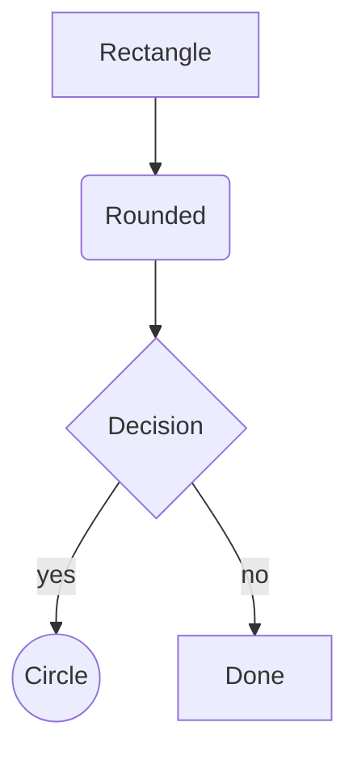
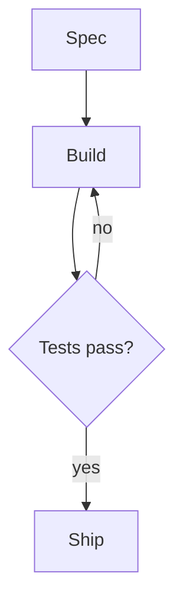
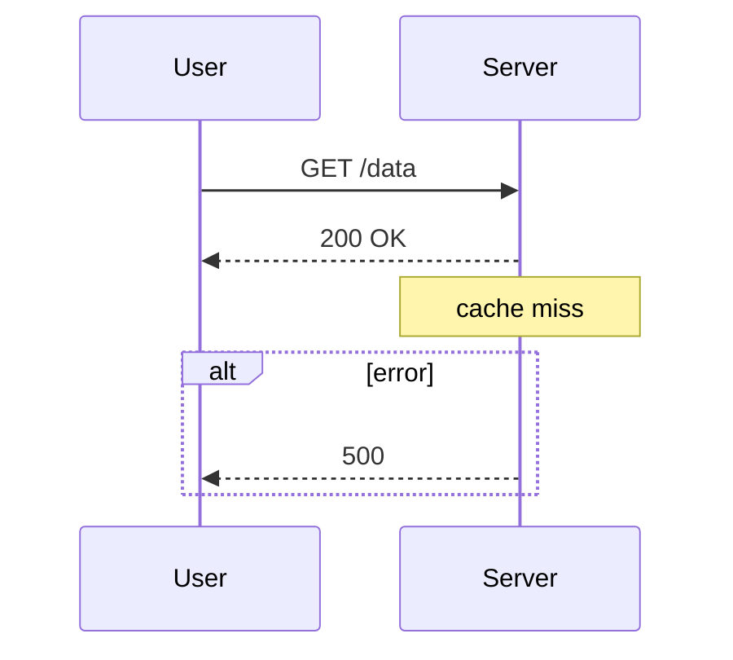
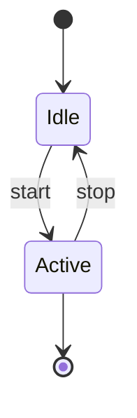
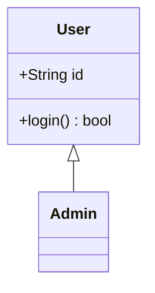
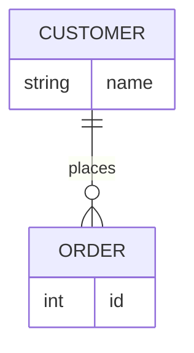
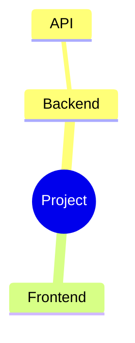

# Mermaid diagrams

Use readable Mermaid source to explain structures, flows, and relationships. Rendering depends on the active host. These conservative templates originated in a terminal renderer with limited syntax; they remain portable defaults, not claims about every renderer's limitations.

## How to render

1. Emit a fenced ` ```mermaid ` block in the reply. Inline rendering is host-dependent; never claim it rendered unless observed.
2. For a complex diagram, use an already available documented renderer or project diagram check. Inspect its supported syntax and fix parser failures before presenting a rendered result.
3. If the host has no renderer, provide the source and state that rendering was unverified. Do not fetch npm packages, install a renderer, or register an integration implicitly.
4. If exporting an artifact is authorized, save the source and inspect the renderer's actual SVG/PNG output. A zero exit code alone does not prove correct layout.

## Supported diagram types

Use one of the following headers when supported by the active renderer. Prefer flowcharts and sequence diagrams for broad portability. Experimental `architecture-beta` and C4 syntax require explicit renderer support.

| Type | Header | Best for |
| --- | --- | --- |
| Flowchart | `flowchart TD` (or `graph TD`) | flows, decisions, pipelines, task plans |
| Sequence | `sequenceDiagram` | calls/messages between actors over time |
| State | `stateDiagram-v2` | state machines (flat only) |
| Class | `classDiagram` | types, fields, relationships |
| Entity-relationship | `erDiagram` | data models |
| Mindmap | `mindmap` | hierarchies / breakdowns |
| Architecture | `architecture-beta` | grouped services |
| C4 context | `C4Context` | system context |

Flowchart directions: `TD` / `TB` (top-down), `LR` (left-right), `RL`, `BT`.
`TD` and `LR` read best in a terminal.

## Flowchart — the workhorse (use this most)

Node shapes — **these four conservative shapes avoid renderer-specific syntax**:



Edges: `-->` (arrow), `---` (line), `-.->` (dotted), `==>` (thick).
Edge labels: `A -->|label| B` or `A -- label --> B`.
Cycles, fan-out, and converging edges all route correctly.

Example — a plan/task graph (a very common request):



## Other type templates

Sequence — supports `participant ... as`, activations `->>+ / -->>-`, `Note over X: …`, and `alt/opt/loop/par … end`:



State (flat only — NO nested `state X { }`):



Class (no generics):



ER (cardinality: `||`=1, `o{`=0..N, `|{`=1..N, `o|`=0..1; `--` solid / `..` dashed):



Mindmap (indentation = depth; use `((text))` or `[text]` for the shape):



## Conservative subset for limited renderers

When renderer support is unknown, avoid the following syntax; these limits originated in a restricted terminal implementation. An inspected renderer may support more:

- **NEVER** use unsupported diagram types: `pie`, `gantt`, `journey`,
  `gitGraph`, `quadrantChart`, `timeline`, `block-beta`. Use only when the actual renderer documents support.
- **NEVER** use flowchart `subgraph … end` — it errors. Group with a mindmap or
  `architecture-beta` instead.
- **NEVER** use exotic node shapes: `([stadium])`, `[(cylinder)]`,
  `[/parallelogram/]`, `{{hexagon}}`, `[[subroutine]]`. The delimiters leak into
  the label (`([X])` renders as the literal text `[X]`). Use only `[ ]`, `( )`,
  `(( ))`, `{ }`.
- **NEVER** use `A & B --> C` (multi-node), `:::class`, `classDef`, `style …`,
  or `click …` in a flowchart — each errors.
- **NEVER** put a `--- title: … ---` YAML frontmatter block above the diagram —
  it errors. Start directly with the diagram header.
- **NEVER** use `<br/>` in a label (it prints literally), class generics like
  `List~T~` (the `~T~` leaks), nested/composite `state X { }` (spawns a phantom
  node), or sequence `autonumber` (errors).
- **AVOID** self-loops (`A --> A`) — they render as an ugly stub.
- **AVOID** long node labels — there is no wrapping, so a long label becomes one
  very wide box. Keep labels to a few words.
- `end` cannot be a node id (reserved). Rename it (e.g. `done`).

## Workflow

1. Pick the diagram type from the table.
2. Write the diagram using only the templates and shapes above; keep labels short.
3. If it has more than ~5 nodes or you are unsure, validate with an available renderer. Fix parser errors and retry; otherwise label rendering unverified.
4. Present the final diagram as a ` ```mermaid ` fenced block in your reply so it
   can be rendered by a supported host.
